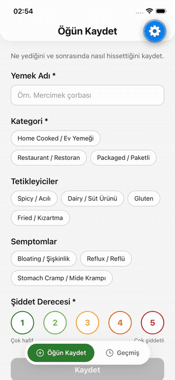

# Rahat Ye 🌿 — Quick Meal & Symptom Logger (PoC)

**🇬🇧 English** | [🇹🇷 Türkçe](README.tr.md)

A React Native (Expo) proof of concept for **Rahat Ye**, a food and digestive-symptom diary for users in Türkiye dealing with reflux, bloating or IBS.

The core idea is **offline-first**: a user may log a meal at a restaurant with poor connectivity, so every log is saved on the device first and synced to the server afterwards. Data is never lost, even when the network request fails.

<p align="center">
  
</p>

---

## ✨ Features

### Task 1 — UI & Form
- Single-scroll **log form**: food name, meal category (Home Cooked / Restaurant / Packaged), trigger tags (Spicy, Dairy, Gluten, Fried), symptom chips (Bloating, Reflux, Stomach Cramp) and a **1–5 severity** selector
- **Validation:** the Save button is disabled until the food name, category and severity are provided; inline error under the food name (shown only after the field is touched) and a list of missing fields
- Interaction feedback: press states on chips and buttons, keyboard-aware scrolling, accessibility labels

### Task 2 — State & Offline Storage
- Global state with **Zustand**, persisted to **AsyncStorage** via the `persist` middleware
- **History screen** (`FlatList`) sorted by date (newest first), showing food name, date/time, category, severity, triggers, symptoms and sync status
- Long-press a card to delete it; empty state when there are no logs
- Badge on the History tab for logs the user hasn't seen yet

### Task 3 — Mock API & Network Handling
- Mock `POST /api/logs` with a **1.5 s delay** and a **10% random failure rate**
- Loading spinner while sending, success confirmation, error message with **Retry**
- Each log has a sync status: `pending` → `synced` / `failed`
- Failed logs can be retried individually or all at once from the History screen
- Logs still `pending` from a previous session are synced automatically on app start

### Bonus
- **Strict TypeScript** for all models, props and navigation routes
- **Light / dark theme** that follows the system setting
- **Jest unit tests** for validation, helpers, the mock API and the store (18 tests)

---

## 🔄 Offline-first data flow

```
Save pressed
  │
  ├─ 1. addLog()  → Zustand store → persist → AsyncStorage   (status: pending)
  │                                                           data is safe on device
  └─ 2. syncLog() → POST /api/logs (mock: 1.5 s, 10% failure)
            ├─ success → status: synced  ✅
            └─ error   → status: failed  ⚠️  → "Retry" (log is kept)
```

---

## 🛠 Tech stack & decisions

| Area | Choice | Why |
|---|---|---|
| Framework | **Expo (SDK 57)** + React Native | Fast setup and testing on device with Expo Go, no native configuration needed |
| Language | **TypeScript (strict)** | Catches invalid data (e.g. a severity of 6 or an unknown category) at compile time |
| State | **Zustand** | Minimal boilerplate compared to Redux for an app of this size; simple selectors and a built-in `persist` middleware |
| Storage | **AsyncStorage** | Works in Expo Go out of the box. MMKV is faster but requires a development build; switching only means changing the `storage` option of `persist` |
| Navigation | **React Navigation 7** (bottom tabs) | De-facto standard; typed route params; custom floating tab bar |
| Testing | **Jest** + `jest-expo` | Business logic is separated from UI, so it can be tested without rendering screens |

---

## 🚀 Getting started

**Prerequisites:** Node.js (LTS), and either the **Expo Go** app on your phone or the iOS Simulator (Xcode) / Android Emulator.

```bash
git clone <this-repo-url>
cd rahat-ye
npm install
npx expo start
```

- **Phone:** scan the QR code with the camera (iOS) or the Expo Go app (Android)
- **iOS Simulator:** press `i` in the terminal
- **Android Emulator:** press `a` in the terminal

### Run tests & type check

```bash
npm test          # Jest unit tests
npx tsc --noEmit  # TypeScript check
```

### Trying the error / retry flow
A 10% failure rate is hard to trigger on demand. In development builds, the bottom of the log form has a **"🧪 Ağ hatası simülasyonu"** switch that makes every request fail. It is wrapped in `__DEV__`, so it never appears in production.

To try dark mode in the iOS Simulator, press `Cmd + Shift + A`.

---

## 📁 Project structure

```
src/
├── components/   Reusable UI: Chip, SeveritySelector, PrimaryButton, LogCard,
│                 StatusBanner, FloatingTabBar, DevNetworkToggle
├── constants/    Option lists (categories, triggers, symptoms) and severity levels
├── navigation/   Bottom tab navigator and typed route params
├── screens/      LogScreen (form) and HistoryScreen (list)
├── services/     Mock API (POST /api/logs)
├── store/        Zustand store with AsyncStorage persistence and sync logic
├── theme/        Light/dark color palettes and theme hooks
├── types/        Data models (LogEntry, Severity, SyncStatus, …)
└── utils/        Pure helpers: validation, toggleItem, id generation, date formatting
```

Tests live next to the code they cover in `__tests__` folders.

---

## ⚖️ Trade-offs & future improvements

- **No real backend.** Only `src/services/api.ts` needs to change to call a real endpoint with `fetch`.
- **Automatic sync on reconnect.** Pending logs are synced on app start; listening to network changes (e.g. `@react-native-community/netinfo`) would sync as soon as the connection returns.
- **Retry with backoff.** Retries are manual; exponential backoff could retry automatically.
- **Edit logs.** Logs can be created and deleted but not edited yet.
- **Insights screen.** e.g. "Which triggers are most often followed by severe symptoms?"
- **Storage scale.** AsyncStorage is fine for a PoC; for thousands of logs, SQLite or MMKV would be a better fit.
- **Component tests.** Current tests cover business logic; screen-level tests with React Native Testing Library could be added.
- **Localization.** Labels are bilingual (EN / TR) in a single string; a proper i18n setup would allow switching languages.
